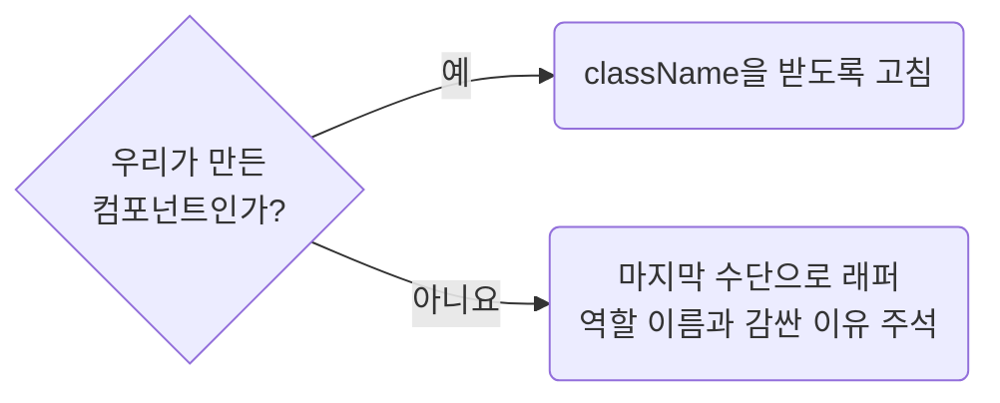

## Do Not Add Wrapper Elements for Styling

**Impact: HIGH (래퍼 요소는 부모 레이아웃 계산을 바꾸고 역할 없는 클래스를 늘립니다)**

스타일을 주기 위해 래퍼 요소를 추가하지 않습니다.
래퍼를 넣으면 부모의 `flex`나 `grid` 아이템이 바뀌어
내부의 `flex`, `grid-area`, 정렬이 부모 레이아웃에 적용되지 않습니다.

역할 없는 래퍼는 `naming-name-elements-and-modifiers-by-role`이 요구하는 이름도 지을 수 없습니다.

**Incorrect 1 (역할 없는 이름의 래퍼를 늘립니다):**

<<< ../examples/composition-do-not-add-wrapper-elements-for-styling/01-incorrect.tsx

**Correct 1 (외부 라이브러리가 `className`을 받지 않으면 역할 이름을 붙여 감쌉니다):**

<<< ../examples/composition-do-not-add-wrapper-elements-for-styling/02-correct.tsx

**Incorrect 2 (래퍼 `div`로 최상위 스타일을 우회합니다):**

<<< ../examples/composition-do-not-add-wrapper-elements-for-styling/03-incorrect-1.tsx

<<< ../examples/composition-do-not-add-wrapper-elements-for-styling/03-incorrect-2.css

**Correct 2 (래퍼를 걷고 컴포넌트에 자기 클래스를 넘깁니다):**

<<< ../examples/composition-do-not-add-wrapper-elements-for-styling/04-correct-1.tsx

<<< ../examples/composition-do-not-add-wrapper-elements-for-styling/04-correct-2.css

**Correct (`className`을 받지 않던 우리 컴포넌트에 계약을 더합니다):**

<<< ../examples/composition-do-not-add-wrapper-elements-for-styling/05-correct.tsx
