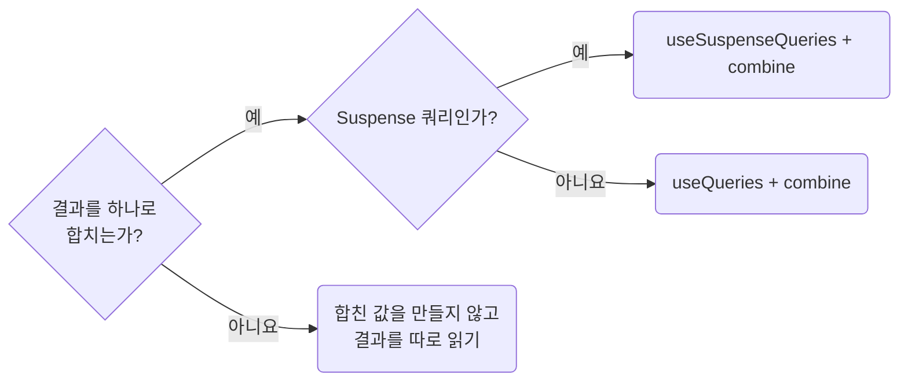

# Combine Multiple Queries With `combine`

**Impact: MEDIUM (여러 응답의 가공 위치를 통일하고 화면 본문의 별칭을 줄입니다)**

둘 이상의 쿼리 결과를 하나로 합칠 때는 값을 렌더하는 섹션에서 `combine`을 인라인으로 씁니다.
결과를 합칠 필요와 요청을 병렬로 시작할 필요는 따로 판단합니다.



| 상황 | 선택 |
| --- | --- |
| Suspense 쿼리 결과를 합침 | `useSuspenseQueries` + `combine`. `isPending`을 만들어 내보내지 않습니다 |
| 일반 쿼리 결과를 합침 | `useQueries` + `combine`. 실제 대기, 실패 상태도 함께 다룹니다 |
| 결과를 각각 렌더함 | 합친 값을 만들지 않습니다. Suspense 병렬 실행이 필요하면 `useSuspenseQueries`에서 결과를 따로 읽습니다 |
| 일반 쿼리의 뒤 요청이 앞 결과를 입력으로 받음 | `enabled`로 입력이 준비된 뒤 실행합니다 |
| Suspense 쿼리의 뒤 요청이 앞 결과를 입력으로 받음 | 같은 컴포넌트에서 `useSuspenseQuery`를 순서대로 호출합니다 |

`useSuspenseQuery`, `useSuspenseQueries`는 `enabled`를 받지 않습니다.
필수 입력이 없으면 쿼리를 호출하는 자식의 렌더를 보류합니다.
독립적인 Suspense 쿼리도 같은 컴포넌트에서 따로 호출하면 앞 요청부터 순서대로 실행됩니다.
한 쿼리만 가공하면 `data-shape-query-data-with-select`를 따르고,
조합을 커스텀 훅으로 옮기는 기준은 `ownership-prefer-plain-ts-for-local-react-helpers`가 정합니다.

**Incorrect 1 (화면 본문에서 두 응답을 꺼내 합칩니다):**

```tsx
const responseProductListSuspense = useProductListSuspense();
const responseCategoryListSuspense = useCategoryListSuspense();

const rows = responseProductListSuspense.data.items.map((product) => ({
	id: product.id,
	categoryName: responseCategoryListSuspense.data.categories.find(
		(category) => category.id === product.categoryId,
	)?.name,
}));
```

**Correct 1 (값을 렌더하는 섹션이 인라인 `combine`으로 합칩니다):**

```tsx
export const PgProductTableSection = () => {
	/**
 * 분류 이름이 목록 응답에 없어 표 한 행에 두 응답을 함께 담음
	 */
	const responseProductRowsSuspense = useSuspenseQueries({
		queries: [productListQueryOptions(), categoryListQueryOptions()],
		combine: ([productResult, categoryResult]) => {
			// 분류 응답의 id는 유일. 모든 행이 같은 분류 목록을 찾으므로 Map은 한 번만 생성
			const categoryById = new Map(categoryResult.data.categories.map((category) => [category.id, category]));

			return {
				rows: productResult.data.items.map((product) => ({
					id: product.id,
					name: product.name,
					categoryName: categoryById.get(product.categoryId)?.name,
				})),
			};
		},
	});

	return <UiTable rows={responseProductRowsSuspense.rows} />;
};
```

> 나머지 예시와 예외는 [full rule](../rules/02-03-data-combine-multiple-queries-with-combine.md)에 있습니다.
