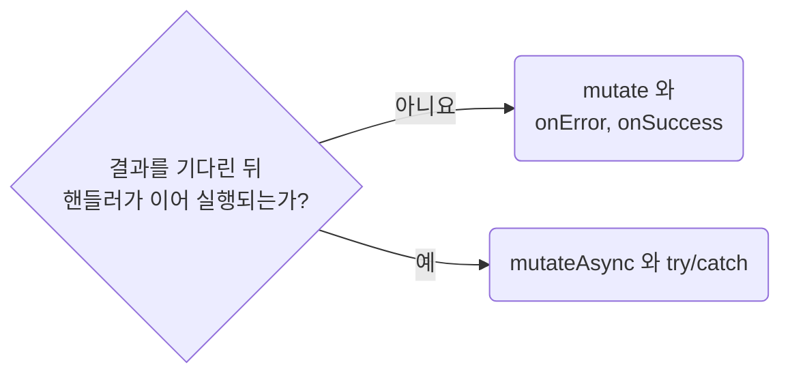

## Handle Mutation Failure Where the Mutation Is Called

**Impact: HIGH (저장 실패를 놓치지 않고 호출한 자리에서 처리합니다)**

뮤테이션 실패는 입력 문맥을 유지할 수 있도록 호출한 자리에서 처리합니다.
기본은 `mutate`와 `useMutation`의 `onError`, `onSuccess`이며, 핸들러에서는 호출만 합니다.

### 호출 방식 고르기

결과를 기다린 뒤 핸들러가 이어서 실행되는지 보고 호출 방식을 고릅니다.

| 상황 | 선택 |
| --- | --- |
| 호출 뒤 핸들러가 더 할 일이 없음 | `mutate` + `onError`, `onSuccess` |
| 결과를 기다린 뒤 핸들러가 계속 실행되어야 함 | `mutateAsync` + `try`/`catch` |

거부된 `mutateAsync` Promise는 오류 경계가 자동으로 받지 않습니다.
`await` 뒤의 코드는 실행되지 않으므로 반드시 `catch`에서 실패를 표시하거나 다시 던집니다.
`throwOnError`로 렌더에서 오류를 다시 던지는 경우는 `runtime-place-error-boundaries-by-blast-radius`를 따릅니다.

### 실패와 중복 실행 처리

| 함께 판단할 내용 | 기준 |
| --- | --- |
| 같은 뮤테이션의 호출 방식 | 호출하는 곳마다 `mutate`와 `mutateAsync`를 섞지 않습니다 |
| 실패 처리 | 빈 `catch`로 삼키지 않습니다. 표시할 내용은 제품에 맞게 정합니다 |
| 중복 실행 방지 | 버튼을 `isPending`으로 `disabled` 처리하고, 핸들러 첫 줄에서도 `isPending`이면 이른 반환으로 끝냅니다 |
| 성공 뒤 캐시 갱신 | `data-invalidate-queries-the-mutation-changed`를 따릅니다 |

**Incorrect 1 (`await`만 쓰고 거부된 Promise를 처리하지 않습니다):**

<<< ../examples/data-handle-mutation-failure-where-it-is-called/01-incorrect.tsx

**Correct 1 (후속 작업이 없는 호출은 성공, 실패 콜백으로 처리합니다):**

<<< ../examples/data-handle-mutation-failure-where-it-is-called/02-correct.tsx

**Correct (버튼과 핸들러 첫 줄에서 중복 저장을 막습니다):**

<<< ../examples/data-handle-mutation-failure-where-it-is-called/03-correct.tsx

**Correct (결과를 기다리는 후속 작업에는 `try`/`catch`를 씁니다):**

<<< ../examples/data-handle-mutation-failure-where-it-is-called/04-correct.tsx
