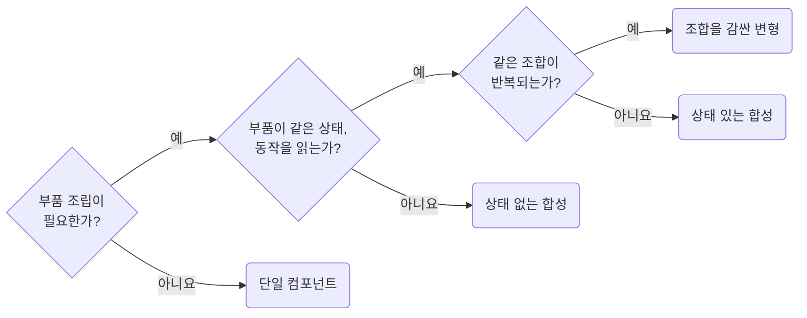

## Choose Single Components, Compound Components, and Variants Deliberately

**Impact: MEDIUM (필요한 확장 범위에 맞춰 단순한 컴포넌트 구조를 선택합니다)**

공용 컴포넌트는 프롭스보다 구조를 먼저 고르고, 현재 필요한 단계까지만 적용합니다.

합성 진입 파일은 부품을 `{Root, Header, Body} as const` 객체 하나로 내보냅니다.
상태 있는 합성은 `Root`가 상태를 소유해 부품에 컨텍스트로 내리며, 상태를 추가해도 사용처의 공개 이름은 유지합니다.
반복되는 조합은 변형으로 감쌉니다.

**Incorrect 1 (단일, 합성, 변형을 구분하지 않고 한 컴포넌트에 모두 구현합니다):**

<<< ../examples/strategy-choose-single-composition-compound-and-variants/01-incorrect.tsx

**Correct 1 (1단계. 확장이 필요 없으면 단일 컴포넌트로 둡니다):**

<<< ../examples/strategy-choose-single-composition-compound-and-variants/02-correct.tsx

**Correct (2단계. 사용처가 부품을 조립해야 하면 상태 없는 합성으로 엽니다):**

<<< ../examples/strategy-choose-single-composition-compound-and-variants/03-correct-1.txt

<<< ../examples/strategy-choose-single-composition-compound-and-variants/03-correct-2.tsx

<<< ../examples/strategy-choose-single-composition-compound-and-variants/03-correct-3.tsx

<<< ../examples/strategy-choose-single-composition-compound-and-variants/03-correct-4.tsx

**Correct (3단계. 부품이 같은 상태를 읽으면 공개 이름을 그대로 두고 컨텍스트만 더합니다):**

<<< ../examples/strategy-choose-single-composition-compound-and-variants/04-correct-1.ts

<<< ../examples/strategy-choose-single-composition-compound-and-variants/04-correct-2.tsx

**Correct (4단계. 같은 조합이 반복되면 이름 붙인 변형으로 감쌉니다):**

<<< ../examples/strategy-choose-single-composition-compound-and-variants/05-correct.tsx
