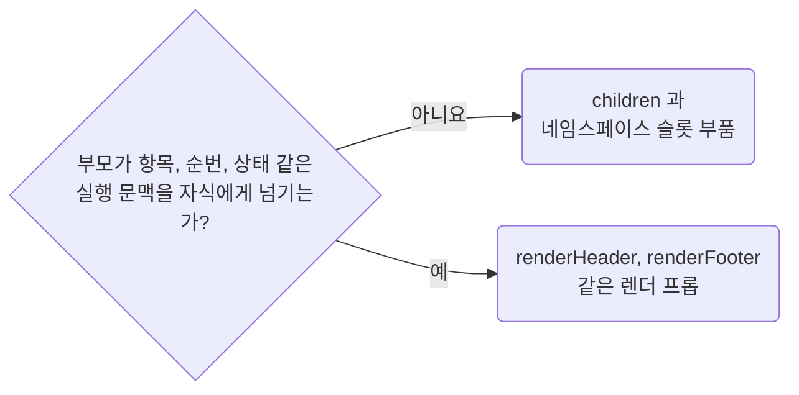

## Prefer Children Over Render Props for Static Composition

**Impact: MEDIUM (실행 문맥이 필요 없는 조립을 JSX 구조로 바로 읽을 수 있습니다)**

상태 없는 합성으로 충분한 공용 컴포넌트는 렌더 프롭보다 `children`을 우선합니다.

| 별도 이름이 필요한 계약 | 이름 |
| --- | --- |
| `ReactNode` 값 | `<Owner>Slot` |
| 실행 문맥을 받아 `ReactNode`를 만드는 함수 | `<Owner>Renderer` |
| 한 번만 쓰는 익명 형태 | 접미사를 붙이려고 새 타입을 만들지 않습니다 |

**Incorrect 1 (정적인 구조를 렌더 프롭으로 조립합니다):**

<<< ../examples/strategy-prefer-children-over-render-props/01-incorrect.tsx

**Correct 1 (부품이 `children`으로 사용처가 넣을 자리를 엽니다):**

<<< ../examples/strategy-prefer-children-over-render-props/02-correct.tsx

**Correct (부품 계약, 진입 파일, 화면 조립을 파일마다 나눕니다):**

<<< ../examples/strategy-prefer-children-over-render-props/03-correct-1.ts

<<< ../examples/strategy-prefer-children-over-render-props/03-correct-2.tsx

<<< ../examples/strategy-prefer-children-over-render-props/03-correct-3.tsx
