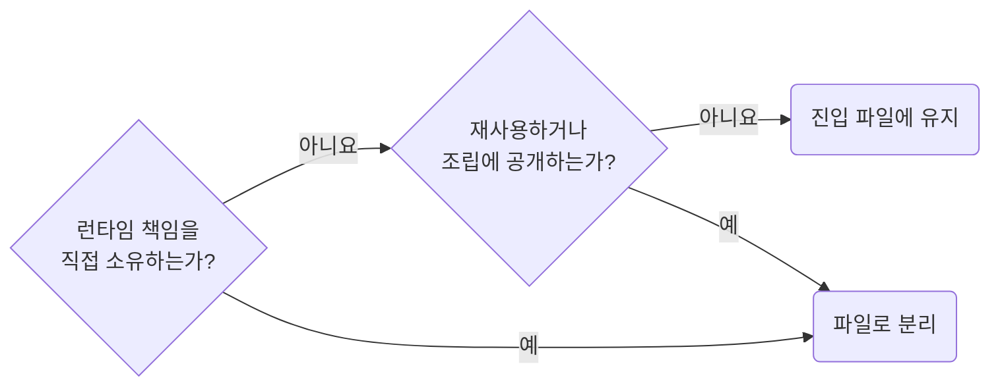

## Split Owner Parts Only for Runtime Boundaries

**Impact: HIGH (자체 책임이 있는 부품만 분리해 소유자 안 파일 수와 구조를 읽기 쉽게 유지합니다)**

`widget`과 `ui` 컴포넌트 안의 부품은 아래 책임 중 하나를 직접 소유할 때만 파일로 뗍니다.
단순 래퍼, `className` 묶음, 들여쓰기 감소, 긴 파일은 분리 근거가 아닙니다.

### 분리 근거가 되는 책임

| 책임 | 예 |
| --- | --- |
| 비동기 | `Suspense`, 스켈레톤, 로딩, 오류, 빈 상태 |
| 상태와 프로바이더 | 지역 상태, 이펙트 동기화, 폼 프로바이더, 컨텍스트, 범위를 좁힌 스토어 |
| 상호작용 | 팝오버, 모달, 선택, 인라인 편집, 드래그, 펼치는 트리 |
| 라이브러리와 성능 | 외부 라이브러리 생명주기 어댑터, 가상 스크롤, 트랜지션, 지연 값 |

### `widget`, `ui` 전용 책임

아래 두 책임은 `widget`, `ui`에만 적용합니다.

| 책임 | 예 |
| --- | --- |
| 재사용 | 같은 소유자 안 두 곳 이상이 같은 부품을 렌더 |
| 조립 | 사용처가 넣고 빼거나 스타일을 바꾸도록 공개하는 합성 부품 |

컨텍스트를 읽어 분기만 하는 부품은 진입 파일에 남깁니다.
라우트 진입 파일의 섹션은 `screen-extract-local-section-components-for-runtime-boundaries`가 같은 기준으로 정합니다.

**Incorrect 1 (컨텍스트를 읽어 분기만 하는 래퍼를 파일로 뗍니다):**

<<< ../examples/composition-split-owner-parts-only-for-runtime-boundaries/01-incorrect.tsx

**Correct 1 (분기는 진입 파일에 남기고 상태를 소유한 부품만 뗍니다):**

<<< ../examples/composition-split-owner-parts-only-for-runtime-boundaries/02-correct.tsx
