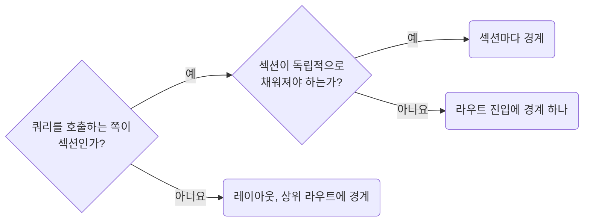

## Place Suspense Boundaries at the Section Owner

**Impact: HIGH (초기 로딩을 섹션 소유자의 경계에서 처리합니다)**

`Suspense` 쿼리를 쓰는 컴포넌트의 바로 위 섹션 소유자에 경계와 대체 화면을 둡니다.
쿼리를 호출하는 컴포넌트는 자기 자신을 경계로 감쌀 수 없습니다.

| 상황 | 경계 위치 |
| --- | --- |
| 섹션이 따로 없음 | 라우트 진입 |
| 라우트 진입이 직접 쿼리를 호출함 | 해당 라우트의 레이아웃 또는 상위 라우트 |
| 섹션이 독립적으로 채워져야 함 | 이때만 경계를 나눕니다. 한 화면에 불필요하게 여러 겹 쌓지 않습니다 |

대체 화면의 컨테이너, 높이는 `css/layout-keep-layout-intent-explicit`을 따릅니다.
본문에 남은 로딩 분기는 `runtime-avoid-ad-hoc-loading-branches`로 판단합니다.

**Incorrect 1 (진입에 경계가 없어 화면 전체가 함께 멈춥니다):**

<<< ../examples/runtime-place-suspense-boundaries-at-the-section-owner/01-incorrect.tsx

**Correct 1 (섹션 소유자가 경계와 대체 화면을 가집니다):**

<<< ../examples/runtime-place-suspense-boundaries-at-the-section-owner/02-correct.tsx

**Incorrect 2 (한 화면에 경계를 여러 겹 쌓습니다):**

<<< ../examples/runtime-place-suspense-boundaries-at-the-section-owner/03-incorrect.tsx

**Correct 2 (라우트 진입이 직접 쿼리를 부르면 진입을 감싸는 레이아웃이 경계를 가집니다):**

<<< ../examples/runtime-place-suspense-boundaries-at-the-section-owner/04-correct.tsx

**Correct (쿼리를 부르는 섹션은 자기 자신을 감싸지 않습니다):**

<<< ../examples/runtime-place-suspense-boundaries-at-the-section-owner/05-correct.tsx
