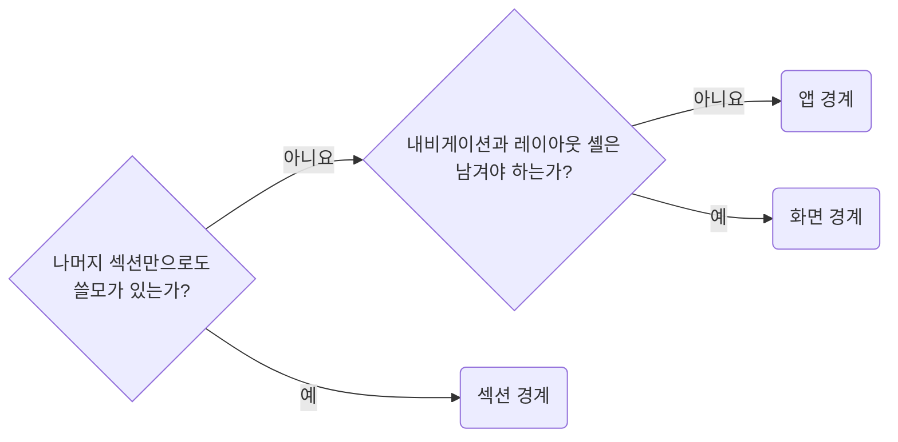

## Place Error Boundaries by How Much Should Survive

**Impact: HIGH (쿼리 실패를 정해진 경계에서 처리하고 필요한 화면을 유지합니다)**

오류 경계는 실패 후에도 남겨야 할 화면 범위로 정합니다.
초기 실패를 받을 경계가 없으면 화면 전체가 빈 채로 남을 수 있으므로 앱 경계는 반드시 둡니다.

### 경계를 둘 층

| 층 | 위치 | 오류 뒤 남는 화면 |
| --- | --- | --- |
| 앱 | 루트에 한 번 | 없음. 마지막 안전망입니다 |
| 화면 | 라우트 진입 | 내비게이션과 레이아웃 셸 |
| 섹션 | `Suspense` 경계와 같은 소유자 | 같은 화면의 다른 섹션 |

목록 실패 후 옆 필터로 할 수 있는 일이 없다면 화면 경계로 충분합니다.
로딩, 오류 경계는 같은 소유자가 조립하며, 위치는 `runtime-place-suspense-boundaries-at-the-section-owner`를 따릅니다.

### 실패 상황별 처리

| 실패 상황 | 처리 |
| --- | --- |
| Suspense 쿼리에 표시할 캐시 데이터가 없음 | 렌더 중 던진 오류를 경계가 받습니다 |
| 기존 데이터가 있는 재조회 실패 | 기본적으로 데이터를 계속 보여 줍니다. 모든 실패를 경계로 보내야 할 때만 재조회가 끝난 뒤 명시적으로 던집니다 |
| 일반 이벤트 핸들러, 비동기 콜백 오류 | 경계가 자동으로 받지 않습니다. 사용자 액션은 `data-handle-mutation-failure-where-it-is-called`를 따릅니다 |
| 트랜지션 Action 오류, 라이브러리가 렌더에서 다시 던진 오류 | 일반 핸들러 오류와 구분합니다 |

### 경계 구현과 재시도

오류 포착 구현은 `ui`의 `UiErrorBoundary`에서 한 번만 제공하며,
`react-error-boundary` 같은 라이브러리에 맡길 수 있습니다.
데이터 라우터의 `errorElement`와 `UiErrorBoundary`를 같은 실패 범위에 겹치지 않습니다.
정상 화면은 유지하면서 오류 상태만 초기화하도록 URL 변경은 `resetKeys`에 연결하고, 경계의 `key`는 바꾸지 않습니다.
재시도 버튼은 대체 화면에서 오류 경계의 재시도 함수를 호출하고,
경계의 `onReset`에는 `useQueryErrorResetBoundary`의 `reset`을 연결합니다.

**Incorrect 1 (캐시가 있는 재조회 실패도 자동으로 경계에 전달된다고 가정합니다):**

<<< ../examples/runtime-place-error-boundaries-by-blast-radius/01-incorrect.tsx

**Correct 1 (낡은 데이터를 허용하지 않는 화면만 재조회 실패를 경계로 보냅니다):**

<<< ../examples/runtime-place-error-boundaries-by-blast-radius/02-correct.tsx

**Incorrect 2 (경계 없이 화면 본문에서 실패를 분기합니다):**

<<< ../examples/runtime-place-error-boundaries-by-blast-radius/03-incorrect.tsx

**Correct 2 (화면 층 경계가 오류를 받으므로 본문에 성공 경로만 남깁니다):**

<<< ../examples/runtime-place-error-boundaries-by-blast-radius/04-correct.tsx

**Correct (셸이 화면 층 오류 경계와 로딩 경계를 조립합니다):**

<<< ../examples/runtime-place-error-boundaries-by-blast-radius/05-correct.tsx

**Correct (나머지 섹션만으로도 쓸모가 있을 때만 섹션 경계를 둡니다):**

<<< ../examples/runtime-place-error-boundaries-by-blast-radius/06-correct.tsx

**Correct (재시도는 오류 경계와 쿼리 오류를 초기화하고 하위 트리를 다시 마운트합니다):**

<<< ../examples/runtime-place-error-boundaries-by-blast-radius/07-correct.tsx
