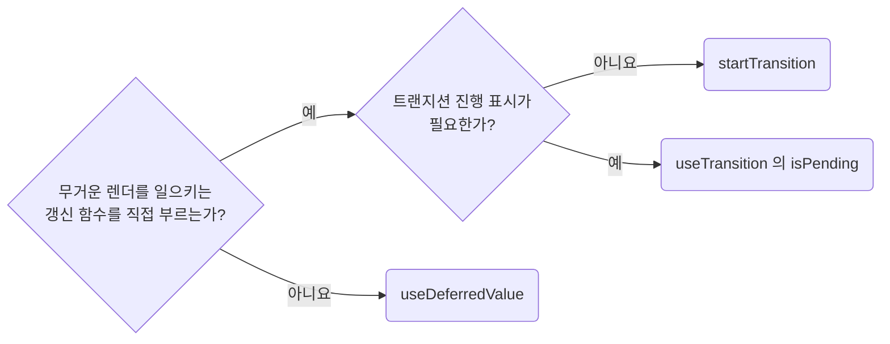

## Defer Heavy Renders Only With Measured Evidence

**Impact: MEDIUM (측정한 렌더 병목에만 트랜지션과 지연 값을 적용합니다)**

`startTransition`, `useTransition`, `useDeferredValue`는 렌더 비용을 측정한 뒤 사용합니다.
목록 행 수와 조작별 소요 시간을 확인하고, 예상 규모만 근거로 삼지 않습니다.

### 지연 도구 고르기

| 상황 | 선택 |
| --- | --- |
| 직접 호출하는 상태 갱신이 무거운 렌더를 일으킴 | `startTransition`으로 호출을 감쌉니다. 프롭으로 받은 갱신 함수도 같습니다 |
| 값은 즉시 반응해야 하지만 파생 렌더는 미룰 수 있음 | `useDeferredValue`로 지연 값을 만듭니다 |
| 갱신 함수를 호출할 수 없고 프롭, 훅 반환값만 받음 | `useDeferredValue`를 씁니다 |
| 트랜지션 진행 표시가 필요함 | 대기 상태를 주지 않는 `startTransition` 대신 `useTransition`의 `isPending`을 씁니다 |

입력값 자체, 폼 오류, 즉시 비활성화 같은 급한 반응은 트랜지션에 넣지 않습니다.
`await` 뒤에는 React가 트랜지션 문맥을 이어 가지 못하므로 상태 갱신을 다시 `startTransition`으로 감쌉니다.

### 최적화 조건

| 무거운 작업 | 최적화 조건 |
| --- | --- |
| 하위 트리 렌더 | 같은 프롭이면 렌더를 건너뛸 수 있어야 합니다. 컴파일러가 이를 제공하지 않으면 지연 값을 받는 컴포넌트를 `memo`로 감쌉니다 |
| 함께 전달하는 객체, 콜백 | 매번 달라지면 `memo`가 있어도 다시 렌더되므로 참조를 확인합니다 |
| 지연 값에서 파생되는 계산 | 컴포넌트 `memo` 대신 `useMemo`로 지연 값이 바뀔 때만 재계산합니다. 측정 근거를 주석으로 남깁니다 |

`startTransition`의 콜백은 즉시 실행되며 안쪽의 무거운 동기 계산이나 네트워크 요청 자체를 미루지 않습니다.
`useDeferredValue`는 고정 지연 시간이 없고 요청 횟수를 줄이는 디바운스도 아닙니다.

**Incorrect 1 (행 20개 목록을 다시 렌더하는 갱신까지 트랜지션으로 감쌉니다):**

<<< ../examples/perf-defer-heavy-renders-with-measured-evidence/01-incorrect.tsx

**Correct 1 (측정 근거가 있는 갱신만 트랜지션으로 감싸고 행 20개 목록은 그대로 둡니다):**

<<< ../examples/perf-defer-heavy-renders-with-measured-evidence/02-correct.tsx

**Incorrect 2 (입력과 무거운 파생 렌더를 같은 값에 묶습니다):**

<<< ../examples/perf-defer-heavy-renders-with-measured-evidence/03-incorrect.tsx

**Correct 2 (입력은 즉시 반응하고 무거운 파생 계산만 늦춥니다):**

<<< ../examples/perf-defer-heavy-renders-with-measured-evidence/04-correct.tsx

**Correct (진행 표시가 필요하면 `useTransition`의 `isPending`을 씁니다):**

<<< ../examples/perf-defer-heavy-renders-with-measured-evidence/05-correct.tsx

**Correct (`await` 뒤의 상태 갱신은 다시 `startTransition`으로 감쌉니다):**

<<< ../examples/perf-defer-heavy-renders-with-measured-evidence/06-correct.tsx

**Correct (지연 값을 받는 무거운 하위 트리는 `memo`로 감쌉니다):**

<<< ../examples/perf-defer-heavy-renders-with-measured-evidence/07-correct.tsx
