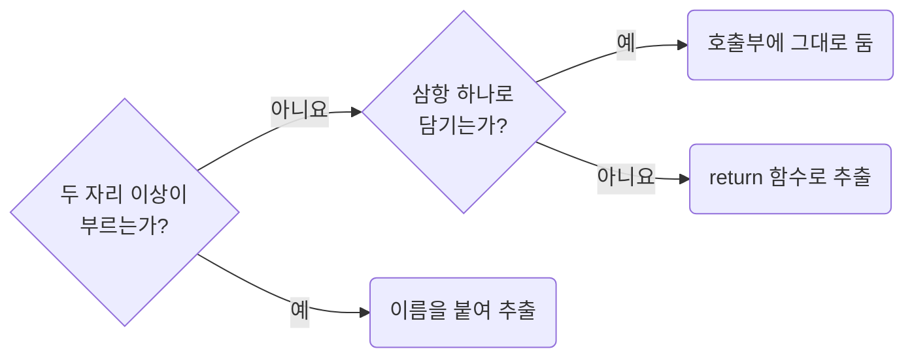

## Extract Support Functions Only When the Boundary Is Real

**Impact: HIGH (불필요한 함수 분리를 줄여 호출부에서 처리 흐름을 읽을 수 있습니다)**

### 이름을 붙이는 사유

한 곳에서만 쓰는 단계는 호출부에 둡니다.
추출한 함수는 바깥 변수, 훅, 컴포넌트 상태 없이도 뜻이 통해야 합니다.

| 허용 사유 | 조건 |
| --- | --- |
| 실제 재사용 | 변경 후 코드에서 두 자리 이상이 그 함수를 부름. 한 줄 함수여도 해당함 |
| 함수 형태가 필수 | 삼항 하나로 표현할 수 없는 판정, `value is T` 타입 가드, 재귀 |

### 추출을 검토할 때

| 추출을 검토하는 이유 | 처리 |
| --- | --- |
| `.map()` 콜백 하나에서만 쓰는 변환 | 그 콜백에 둡니다 |
| 값이 두 분기로 갈림 | 호출부에서 삼항 하나로 씁니다 |
| 값이 세 분기 이상으로 갈림 | 함수로 추출하고 분기마다 `return`으로 끝냅니다 |

분기를 줄이려면 추출 전에 `absence-check-once-at-the-boundary`와
`values-decide-once-and-carry-the-result`를 먼저 봅니다.
함수 배치는 `functions-give-each-function-its-own-file`,
루트 승격은 `functions-promote-owner-free-functions-to-root-util`이 정합니다.

**Incorrect 1 (한 자리에서만 쓰는 단계를 함수로 떼어 내 흐름이 파일 안에서 흩어집니다):**

<<< ../examples/functions-extract-helpers-only-when-the-boundary-is-real/01-incorrect-1.txt

<<< ../examples/functions-extract-helpers-only-when-the-boundary-is-real/01-incorrect-2.ts

**Correct 1 (한 번 쓰는 단계는 호출부에 두고 재사용하는 계산은 함수로 추출합니다):**

<<< ../examples/functions-extract-helpers-only-when-the-boundary-is-real/02-correct-1.txt

<<< ../examples/functions-extract-helpers-only-when-the-boundary-is-real/02-correct-2.ts

**Incorrect 2 (한 번만 쓰는 한 줄 계산을 파일로 떼어 내 호출부가 가져옵니다):**

<<< ../examples/functions-extract-helpers-only-when-the-boundary-is-real/03-incorrect.tsx

**Correct 2 (작은 계산은 쓰는 자리에 그대로 둡니다):**

<<< ../examples/functions-extract-helpers-only-when-the-boundary-is-real/04-correct.tsx

**Correct (서로 다른 파일 둘이 이미 부르는 순수 함수를 뺍니다):**

<<< ../examples/functions-extract-helpers-only-when-the-boundary-is-real/05-correct-1.ts

<<< ../examples/functions-extract-helpers-only-when-the-boundary-is-real/05-correct-2.tsx

**Correct (삼항 하나에 담기지 않는 판정은 호출부가 하나여도 함수로 추출하고 분기마다 `return`으로 끝냅니다):**

<<< ../examples/functions-extract-helpers-only-when-the-boundary-is-real/06-correct.ts
