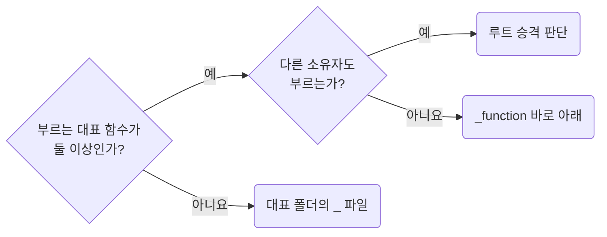

## Give Each Support Function Its Own File

**Impact: HIGH (보조 함수를 개별 파일로 관리하고 폴더로 소유 관계를 드러냅니다)**

### 호출부에 따른 자리

보조 함수에 이름을 붙일지는 `functions-extract-helpers-only-when-the-boundary-is-real`이 정합니다.
이름을 붙였다면 함수마다 파일을 하나 두고, 부르는 대표 함수에 따라 배치합니다.

부르는 대표 함수가 둘 이상인지 먼저 보고, 둘 이상이면 다른 소유자도 부르는지에 따라 보조 함수의 자리를 고릅니다.

| 호출부 | 위치 |
| --- | --- |
| 대표 함수 하나 | `_function/<대표>/<대표>.ts`와 같은 폴더의 `_<보조>.ts` |
| 같은 소유자의 대표 함수 둘 이상 | `_function/<보조>.ts`. 기존 `_` 접두사를 뗍니다 |
| 다른 소유자 | `functions-promote-owner-free-functions-to-root-util`로 루트 승격 여부를 판단합니다 |

### 파일 배치 규범

| 배치 대상 | 규범 |
| --- | --- |
| 대표 함수 | 내보낸 함수 하나당 파일 하나이며 파일 이름은 함수 이름입니다 |
| 대표만 쓰는 보조 | 대표 파일 아래 비공개 `const`로 쌓지 않고 같은 이름 폴더의 `_` 파일로 둡니다 |
| 보조의 보조 | 같은 폴더의 `_` 파일로 둡니다. 하위 폴더를 더 만들지 않습니다 |
| 타입, 상수 | 이 폴더에 두지 않고 프레임워크 규칙이 정한 소유자의 역할 폴더에 둡니다 |
| `helper.ts`, `helpers.ts`, `utils.ts` | 여러 보조를 모으는 파일로 만들지 않습니다 |

`_` 파일은 같은 폴더에서만 가져옵니다.
대표와 `_` 파일, `_` 파일끼리의 호출은 대표의 내부이며 재노출 사슬이 아닙니다.
루트 `util`끼리의 직접 가져오기도 각 공개 진입점의 출처가 드러나므로 허용합니다.
부르는 대표 함수나 소유자가 늘면 표에서 다음 행의 배치를 검토합니다.

**Incorrect 1 (여러 보조를 모은 파일에서 내보낸 함수가 세 단계로 이어집니다):**

<<< ../examples/functions-give-each-function-its-own-file/01-incorrect.ts

**Correct 1 (소유자 아래 대표 함수 하나에 파일 하나를 둡니다):**

<<< ../examples/functions-give-each-function-its-own-file/02-correct.ts

**Incorrect 2 (대표 함수 하나만 부르는 보조를 대표 파일 아래 비공개 `const`로 쌓습니다):**

<<< ../examples/functions-give-each-function-its-own-file/03-incorrect.txt

**Correct 2 (자기만 쓰는 보조가 생긴 대표 함수는 자기 이름 폴더를 갖고 보조는 `_` 파일입니다):**

<<< ../examples/functions-give-each-function-its-own-file/04-correct.txt

**Incorrect 3 (한 대표만 부르는 보조를 `_function` 바로 아래에 내보내 둡니다):**

<<< ../examples/functions-give-each-function-its-own-file/05-incorrect.txt

**Correct 3 (두 대표가 부르게 된 뒤에 `_function` 바로 아래로 올리고 `_`를 뗍니다):**

<<< ../examples/functions-give-each-function-its-own-file/06-correct.txt
