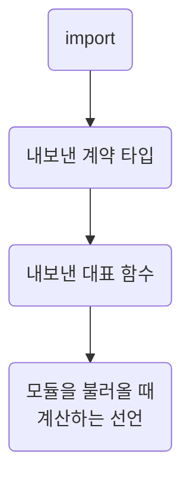

## Order Declarations Top Down

**Impact: HIGH (파일을 열면 내보낸 함수가 먼저 보이고 호출부에서 호출 대상으로 이어집니다)**

내보낸 계약과 대표 함수를 먼저 보여 주되, 모듈 초기화 시 필요한 선언 순서를 지킵니다.
선언은 파일 위에서 아래로 다음 순서로 놓습니다.

함수 본문 참조는 호출 시점에 읽으므로 모듈 초기화가 끝난 뒤 부르면 참조 대상이 아래에 있어도 됩니다.
즉시 계산하는 선언은 자기가 부르는 선언 뒤에 둡니다.

**Incorrect 1 (내보낸 계약 타입이 함수 아래에 있어 시그니처를 읽으려면 파일을 끝까지 내려가야 합니다):**

<<< ../examples/functions-order-declarations-top-down/01-incorrect.ts

**Correct 1 (내보낸 계약 타입이 먼저, 그 계약을 받는 함수가 바로 아래에 옵니다):**

<<< ../examples/functions-order-declarations-top-down/02-correct.ts

**Incorrect 2 (모듈을 불러올 때 계산되는 선언이 자기가 부르는 선언보다 위에 있습니다):**

<<< ../examples/functions-order-declarations-top-down/03-incorrect.ts

**Correct 2 (모듈을 불러올 때 계산되는 선언은 자기가 부르는 선언 뒤에 둡니다):**

<<< ../examples/functions-order-declarations-top-down/04-correct.ts
