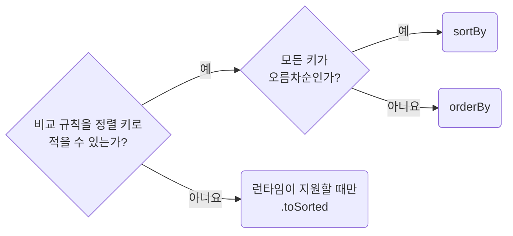

## Prefer Immutable Array Sorting

**Impact: HIGH (프롭스, 상태, 모듈 상수에서 온 배열을 정렬할 때 원본이 바뀌는 버그를 피합니다)**

정렬은 새 배열을 반환하는 `es-toolkit` 함수로 하고, 원본을 바꾸는 `.sort()`는 쓰지 않습니다.
프롭스, 상태, 매개변수, 모듈 상수로 받은 배열도 같습니다.

같은 키의 항목도 입력 순서와 무관하게 정렬해야 하면 고유 식별자를 마지막 정렬 키로 더합니다.
입력을 수정하지 않는 정렬 함수는 `readonly` 배열을 매개변수로 받습니다.

**Incorrect 1 (매개변수로 받은 배열을 제자리에서 바꿉니다):**

<<< ../examples/values-prefer-immutable-array-sorting/01-incorrect.ts

**Correct 1 (키 기준 정렬은 `sortBy`를 씁니다):**

<<< ../examples/values-prefer-immutable-array-sorting/02-correct.ts

**Correct (방향이 섞이면 `orderBy`를 씁니다):**

<<< ../examples/values-prefer-immutable-array-sorting/03-correct.ts

**Correct (비교 규칙을 키로 적을 수 없으면 `.toSorted()`를 씁니다):**

<<< ../examples/values-prefer-immutable-array-sorting/04-correct.ts
