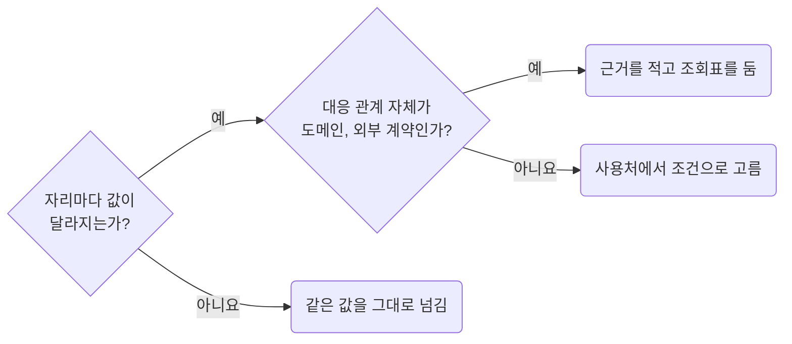

## Avoid Lookup Tables for Simple Value Choices

**Impact: HIGH (값과 선택 조건이 사용처에 함께 남아 선택 기준을 바로 읽을 수 있습니다)**

한 곳에서 쓸 값을 고르려고 객체나 `Map`으로 조회표를 만들지 않습니다.
같은 값은 그대로 넘기고 값이 달라질 때만 사용처에서 조건으로 고릅니다.
조회표는 여러 키의 대응 관계 자체가 도메인이나 외부 계약일 때만 두고, 선언 바로 위에 그 근거를 적습니다.

**Incorrect 1 (한 곳의 프롭 값을 고르려고 조회표를 만듭니다):**

<<< ../examples/values-avoid-lookup-tables-for-simple-choices/01-incorrect.tsx

**Correct 1 (값이 달라지는 조건을 사용처에 적습니다):**

<<< ../examples/values-avoid-lookup-tables-for-simple-choices/02-correct.tsx

**Incorrect 2 (계약 조회표를 근거 없이 둡니다):**

<<< ../examples/values-avoid-lookup-tables-for-simple-choices/03-incorrect.ts

**Correct 2 (외부 코드와 화면 상태의 대응 관계가 계약이면 이유를 남기고 조회표를 둡니다):**

<<< ../examples/values-avoid-lookup-tables-for-simple-choices/04-correct.ts
