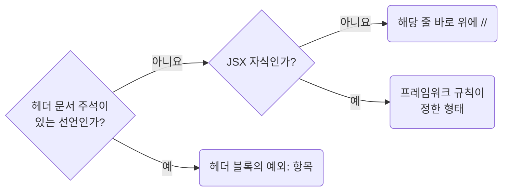

## Justify Convention Exceptions With a Checkable Reason Comment

**Impact: MEDIUM (예외가 취향인지 근거가 있는지 코드에서 바로 드러납니다)**

### 확인할 수 있는 근거

규칙이 허용한 예외에는 다른 사람이 확인할 수 있는 근거를 주석으로 남깁니다.
“성능을 위해”, “안전하게”, “필요해서”처럼 확인할 수 없는 말은 예외의 근거가 되지 않습니다.

| 근거 | 적을 내용 |
| --- | --- |
| 외부 패키지, API 제약 | 어떤 API가 무엇을 요구하는지 |
| 측정 결과 | 측정 대상과 수치 |
| 제품 명세, 티켓 | 결정이 기록된 위치 |
| 상수 | `constant` 폴더에 선언된 이름 |

### 주석 자리

헤더 문서 주석이 있는 선언인지 먼저 보고, 아니면 JSX 자식인지에 따라 이유를 적을 자리를 고릅니다.

헤더 블록에서는 `예외:` 태그를 단 목록 항목으로 적습니다.
어투와 상자 꼴은 `docs-write-korean-comments-about-purpose-and-constraints`를 따릅니다.

**Incorrect 1 (확인할 수 없는 말로 예외를 정당화합니다):**

<<< ../examples/docs-justify-convention-exceptions-with-a-reason-comment/01-incorrect.ts

**Correct 1 (외부 패키지의 제약을 가리킵니다):**

<<< ../examples/docs-justify-convention-exceptions-with-a-reason-comment/02-correct.ts

**Incorrect 2 (막연한 말이라 무엇을 재서 넣었는지 알 수 없습니다):**

<<< ../examples/docs-justify-convention-exceptions-with-a-reason-comment/03-incorrect.ts

**Correct 2 (측정 결과를 가리킵니다):**

<<< ../examples/docs-justify-convention-exceptions-with-a-reason-comment/04-correct.ts
